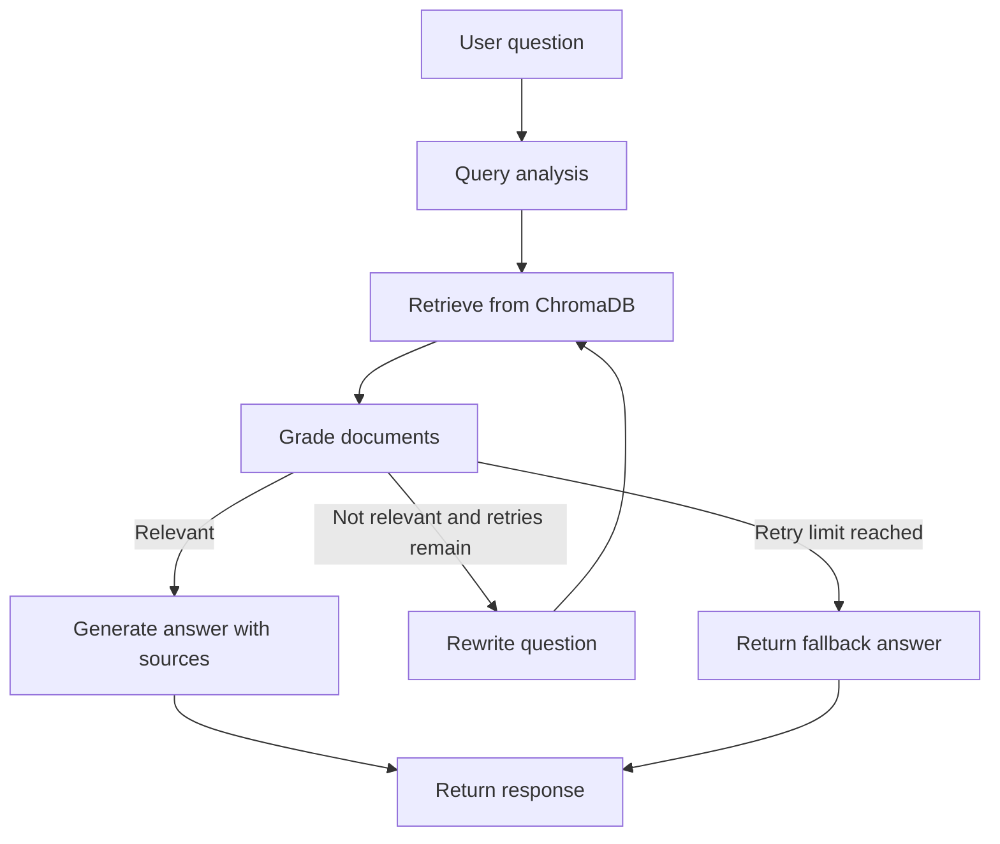

# RAG Technical Assistant

A Retrieval-Augmented Generation (RAG) application for answering questions from a small collection of technical documents. It uses LangGraph for a self-corrective workflow, ChromaDB for document retrieval, Gemini for language and embedding models, and FastAPI for the API.

## Features

- Ingests Markdown documents from the `data/` folder.
- Splits documents into chunks, creates embeddings, and stores them in ChromaDB.
- Retrieves and grades documents before generating an answer.
- Rewrites the question and retries when retrieved documents are not relevant.
- Returns a fallback answer when the available documents cannot answer the question.
- Includes API endpoints for querying, ingestion, listing documents, and feedback.

## Architecture



## Project Structure

```text
rag-project/
├── app/
│   ├── graph.py
│   ├── ingestion.py
│   ├── main.py
│   ├── nodes.py
│   └── state.py
├── data/
│   ├── fastapi_tutorial.md
│   ├── langgraph_basics.md
│   └── pydantic_models.md
├── scripts/
│   └── download_docs.py
├── .env                 # Local API key; do not commit
├── .gitignore
├── requirements.txt
└── README.md
```

## Requirements

- Python 3.11
- A Google Gemini API key
- Internet connection for Gemini API requests

## Setup on Windows PowerShell

Run these commands from the project folder:

```powershell
python -m venv venv
.\venv\Scripts\Activate.ps1
python -m pip install -r requirements.txt
```

Create a `.env` file in the project root:

```env
GOOGLE_API_KEY=your_google_api_key
```

Keep the key private. The `.gitignore` file excludes `.env`.

## Run the Application

Start the FastAPI server:

```powershell
python -m uvicorn app.main:app --reload
```

Open the interactive API documentation:

```text
http://127.0.0.1:8000/docs
```

## API Endpoints

### `POST /query`

Ask a question about the indexed documents.

```powershell
$body = @{ question = "What are nodes and edges in LangGraph?" } | ConvertTo-Json
Invoke-RestMethod -Uri "http://127.0.0.1:8000/query" -Method Post -ContentType "application/json" -Body $body
```

The response includes an answer, source document names, and the retry count.
### POST `/ingest`

Upload one Markdown (`.md`) or text (`.txt`) file. The API saves it in the `data/` folder, splits it into chunks, creates Gemini embeddings, and indexes those chunks in ChromaDB.

- Content type: `multipart/form-data`
- Form field: `file`
- Swagger test: open `/docs`, select `POST /ingest`, click **Try it out**, choose a `.md` or `.txt` file, then click **Execute**.

Example success response:

```json
{
  "message": "Document ingested successfully",
  "file": "upload_check.md"
}

### `GET /documents`

List the indexed documents.

```powershell
Invoke-RestMethod -Uri "http://127.0.0.1:8000/documents"
```

### `POST /feedback`

Submit feedback about an answer. `rating` is numeric.

```powershell
$body = @{
    query = "What are nodes and edges in LangGraph?"
    answer = "Nodes process state; edges decide which node runs next."
    rating = 1
    comment = "Helpful answer"
} | ConvertTo-Json

Invoke-RestMethod -Uri "http://127.0.0.1:8000/feedback" -Method Post -ContentType "application/json" -Body $body
```

## Design Decisions

- **ChromaDB:** provides local persistent storage for document embeddings.
- **Gemini embeddings:** converts document chunks and questions into vectors for similarity-based retrieval.
- **LangGraph:** represents the query, retrieval, grading, rewrite, and generation steps as a workflow.
- **Bounded retries:** the workflow retries an unsuccessful retrieval a limited number of times, then returns a fallback answer.
- **Local Markdown corpus:** keeps the sample corpus easy to inspect and update.

## Tested Locally

- `GET /documents` returned the three indexed Markdown documents.
- A LangGraph question returned an answer with `langgraph_basics.md` as a source.
- A question outside the indexed corpus returned a fallback answer with no sources after retries.
- `POST /feedback` returned a successful response.

## Limitations and Possible Improvements

- Answers are limited to the indexed documents and may not cover topics outside them.
- Gemini API access and an internet connection are required.
- Future improvements could include document upload support, automated answer-grounding checks, chat history, and a simple web interface.